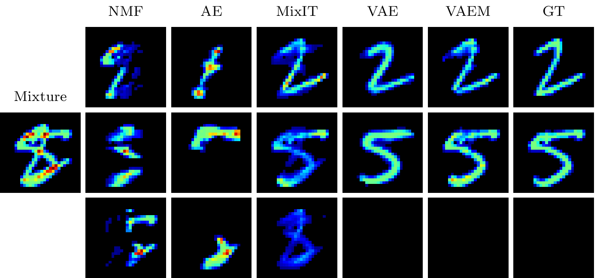
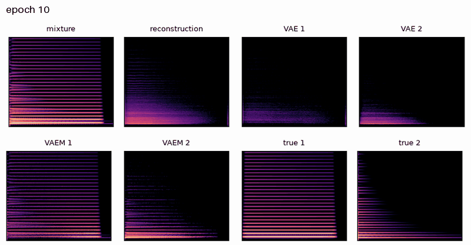
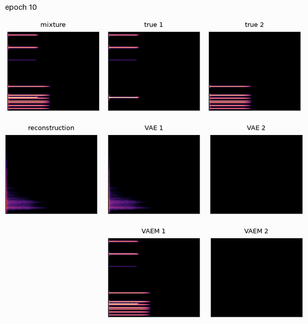
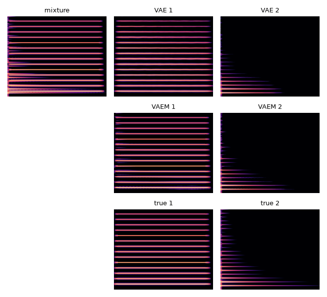
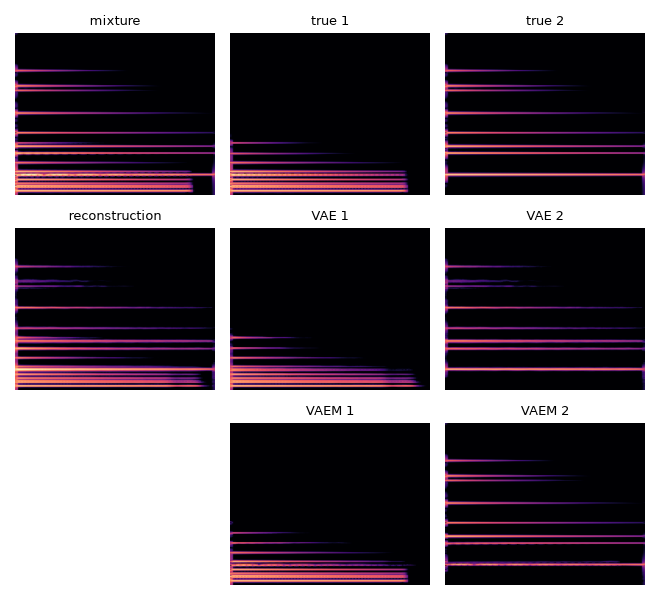
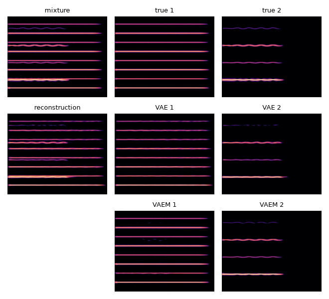

# VAE-BSS

> **New: [DVAE-BSS](https://github.com/jundsp/DVAE-BSS)** adds a dynamical prior, so it separates audio of any length, with a pretrained model and a one-command `dvae-separate`. [Listen to examples](https://jundsp.github.io/DVAE-BSS/).
  
A PyTorch model of the variational auto-encoder for unsupervised blind source separation, with training and evaluation programs, as described in

* J. Neri, R. Badeau, P. Depalle, “[**Unsupervised Blind Source Separation with Variational Auto-Encoders**](https://hal.science/hal-03255341)”, 29th European Signal Processing Conference (EUSIPCO), Dublin, Ireland, August 2021. [doi:10.23919/EUSIPCO54536.2021.9616154](https://doi.org/10.23919/EUSIPCO54536.2021.9616154)

Includes pre-trained models located in `saves/pretrained` (~75 MB total).

Author: Julian Neri


## Instructions

### Installation

```bash
git clone https://github.com/jundsp/VAE-BSS.git
cd VAE-BSS
pip install -r requirements.txt
```

### Usage

Run either the `evaluate.py` or `train.py` files.
* For example, enter this command in terminal: `python3 evaluate.py`

**`evaluate.py`** uses models that we pre-trained in an unsupervised way to separate mixed MNIST handwritten digit images.
Results for K = 2, 3, 4 assumed model sources are saved in the results directory. The models include normal auto-encoders, variational auto-encoders, and the VAE with masking, to compare their qualities. The VAEs, with or without masking, perform high quality separation without knowing the true number of source images in the mixture and without ever having access to the true ground truth source images. With `--checkpoint saves/<model>.pt`, it instead scores a model trained by `train.py` on its dataset's test set.

**`train.py`** starts from scratch and trains a VAE model solely on data mixtures in an unsupervised way. It demonstrates the training procedure described in our paper. `--dataset` picks the data (`mnist`, the default, or `audio_synthetic`, see [Audio](#audio)), and options that are not given take that dataset's settings from the paper (see `python train.py --help` and `defaults` in `src/datasets/`). For MNIST, separation is clear within the first 10 epochs (the default). You should get about the same results as the pre-trained models if you train over a few thousand epochs, following the training settings defined in our paper. The other arguments allow you to try different hyperparameters and settings for model training / specification, such as the number of model sources (`--sources`), the dimension of the latent space, the prior probability, the batch size, or a deterministic auto-encoder (`--variational False`). MNIST models are saved to `saves/model_<vae|ae>_K<sources>.pt` and figures to `results/`; the pretrained models in `saves/pretrained` are never overwritten. `--resume` continues a run from its last save, with the optimizer, learning-rate schedule and random state saved next to the model (`<model>.train.pt`), so a resumed run gives the same results as an uninterrupted one; raise `--epochs` to train longer. With the cosine schedule (the audio default), a resumed run with a new `--epochs` starts a new cosine from the current learning rate down to `--min-lr` at the new last epoch; a run that already reached `--min-lr` stays there unless `--learning-rate` sets a new starting rate.

Either program will first download the MNIST data and prepare it as training and testing datasets. The datasets are saved in a directory that will be recalled for subsequent use.



### Code layout

* `train.py`, `evaluate.py`: shared by all datasets.
* `src/model.py`: the VAE and its loss; `src/utils.py`: MNIST mixing, KL divergences, masks, permutation.
* `src/processing.py`: STFT processing of the audio version; `src/metrics.py`: SI-SDR, SIR, SAR.
* `src/datasets/`: one module per dataset (`mnist.py`, `audio_synthetic.py`) with its loaders, mixing, default settings, scores and figures; `notes.py` loads pairs of notes; `synthetic_notes.py` generates the notes.

### Audio

The audio version separates mixtures of two musical notes from their spectrograms, as in the paper's MUMS experiment (Section V and Table III; Section 6.2.6 of the [dissertation](https://hdl.handle.net/20.500.14905/94099)). MUMS is licensed, so this repository trains on the synthetic notes of [DVAE-BSS](https://github.com/jundsp/DVAE-BSS) instead: plucked and bowed strings, reeds, brass, bells and organs with random pitch, timbre, vibrato and decay. There is no pretrained audio model.

This is a smaller model (half the paper's layer widths), trained on a smaller, synthetic dataset than the paper's results used, so the separations are not perfect. It is a starting point for your own project: settings and a training script that work, to build on with a larger model (`--hidden 2560 2048 1536 1024 512` is the paper's size) and your own audio (mono 44.1 kHz .wav notes under `train/`, `valid/` and `test/` in one folder, passed with `--data-directory`).

```bash
python -m src.datasets.synthetic_notes      # 3000 training, 750 validation and 750 test notes in data/audio_synthetic (500 MB, ~1 min)
python train.py --dataset audio_synthetic    # 1000 epochs, about an hour on an Apple-silicon GPU
python evaluate.py --checkpoint saves/audio_synthetic_c0.5_vae_K2.pt
```

Training, epochs 10 to 1000, on two validation mixtures: the mixture and the true notes (top), the model's reconstruction of the mixture and its two decoded sources (VAE, middle), and its mask-based sources (VAEM, bottom).





| 1000 epochs, test set (dB) | VAE | VAEM | VAEW | IBM | IRM |
|---|---|---|---|---|---|
| SI-SDR | 8.06 | 14.01 | 13.92 | 23.72 | 21.80 |
| SIR | 31.84 | 32.88 | 21.63 | 46.34 | 33.58 |
| SAR | 8.48 | 15.26 | 16.86 | 23.80 | 22.14 |

Medians over 750 held-out test notes; IBM and IRM are the ideal binary and ratio masks (upper bounds). SIR and SAR are scale-invariant (Le Roux et al., 2019), so only SI-SDR compares directly with the paper.

Listen to three test mixtures: the model's mask-based separations (VAEM) next to the true notes.

**Brass + plucked string** (VAEM SI-SDR 26.8, 16.4 dB): [mixture](docs/audio/example_1/mixture.wav) · separated [1](docs/audio/example_1/vaem_1.wav), [2](docs/audio/example_1/vaem_2.wav) · true [1](docs/audio/example_1/true_1.wav), [2](docs/audio/example_1/true_2.wav)



**Two bells** (VAEM SI-SDR 8.2, 4.9 dB): [mixture](docs/audio/example_2/mixture.wav) · separated [1](docs/audio/example_2/vaem_1.wav), [2](docs/audio/example_2/vaem_2.wav) · true [1](docs/audio/example_2/true_1.wav), [2](docs/audio/example_2/true_2.wav)



**Two reeds** (VAEM SI-SDR 29.6, 32.8 dB): [mixture](docs/audio/example_3/mixture.wav) · separated [1](docs/audio/example_3/vaem_1.wav), [2](docs/audio/example_3/vaem_2.wav) · true [1](docs/audio/example_3/true_1.wav), [2](docs/audio/example_3/true_2.wav)



Settings (see `defaults` in `src/datasets/audio_synthetic.py`):

* 44.1 kHz, 2048-point STFT, hop 512; the first 256 bins (5.5 kHz) and 128 frames (1.5 s) of each note; two random notes mixed anew every epoch;
* 64-dimensional latent per source, Laplace likelihood, Gaussian prior, β rising from 0 to 0.5 over 100 epochs, Adam with batches of 128;
* three changes from the paper, which made these notes separate much sooner: learning rate 1e-3 (paper 1e-4), a cosine schedule down to 1e-4, and magnitudes compressed to |STFT|^0.5 (`--compression 1` for none). With compression the masked sources no longer add up to the mixture, so `evaluate.py` also reports VAEW, a Wiener filter whose sources do;
* separated audio uses the mixture's phase.

Training saves the model to `saves/` and, every 10 epochs, spectrogram figures, `progress.png` (losses and validation SI-SDR) and `log.csv` to `results/<run>/`. The model has 89 M parameters, so a GPU is recommended (Apple-silicon MPS is used when available).
