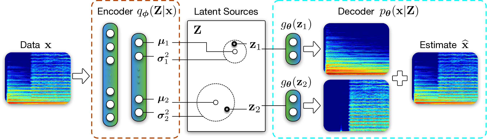

# VAE-BSS

> **New: [DVAE-BSS](https://github.com/jundsp/DVAE-BSS)** adds a dynamical prior, so it separates audio of any length, with a pretrained model and a one-command `dvae-separate`. [Listen to examples](https://jundsp.github.io/DVAE-BSS/).
  
A PyTorch model of the variational auto-encoder for unsupervised blind source separation, with training and evaluation programs, as described in

* J. Neri, R. Badeau, P. Depalle, “[**Unsupervised Blind Source Separation with Variational Auto-Encoders**](https://hal.science/hal-03255341)”, 29th European Signal Processing Conference (EUSIPCO), Dublin, Ireland, August 2021. [doi:10.23919/EUSIPCO54536.2021.9616154](https://doi.org/10.23919/EUSIPCO54536.2021.9616154)

Includes pre-trained models located in `saves/pretrained` (~75 MB total).

Author: Julian Neri




## Instructions

### Installation

```bash
git clone https://github.com/jundsp/VAE-BSS.git
cd VAE-BSS
pip install -r requirements.txt
```

### Usage

Run either the `evaluate.py` or `train.py` files.
* For example, enter this command in terminal: `python3 evaluate.py`

**`evaluate.py`** uses models that we pre-trained in an unsupervised way to separate mixed MNIST handwritten digit images.
Results for K = 2, 3, 4 assumed model sources are saved in the results directory. The models include normal auto-encoders, variational auto-encoders, and the VAE with masking, to compare their qualities. The VAEs, with or without masking, perform high quality separation without knowing the true number of source images in the mixture and without ever having access to the true ground truth source images. With `--checkpoint saves/<model>.pt`, it instead scores a model trained by `train.py` on its dataset's test set.

**`train.py`** starts from scratch and trains a VAE model solely on data mixtures in an unsupervised way. It demonstrates the training procedure described in our paper. `--dataset` picks the data (`mnist`, the default, or `audio_synthetic`, see [Audio](#audio)), and options that are not given take that dataset's settings from the paper (see `python train.py --help` and `defaults` in `src/datasets/`). For MNIST, separation is clear within the first 10 epochs (the default). You should get about the same results as the pre-trained models if you train over a few thousand epochs, following the training settings defined in our paper. The other arguments allow you to try different hyperparameters and settings for model training / specification, such as the number of model sources (`--sources`), the dimension of the latent space, the prior probability, the batch size, or a deterministic auto-encoder (`--variational False`). MNIST models are saved to `saves/model_<vae|ae>_K<sources>.pt` and figures to `results/`; the pretrained models in `saves/pretrained` are never overwritten.

Either program will first download the MNIST data and prepare it as training and testing datasets. The datasets are saved in a directory that will be recalled for subsequent use.

### Audio

The audio version separates mixtures of two musical notes from their spectrograms, as in the paper's MUMS experiment (Section V and Table III; Section 6.2.6 of the [dissertation](https://hdl.handle.net/20.500.14905/94099)). MUMS is licensed, so this repository trains on the synthetic notes of [DVAE-BSS](https://github.com/jundsp/DVAE-BSS) instead: plucked and bowed strings, reeds, brass, bells and organs with random pitch, timbre, vibrato and decay. There is no pretrained audio model.

```bash
python -m src.datasets.synthetic_notes      # 3000 training + 750 test notes in data/audio_synthetic (420 MB, ~1 min)
python train.py --dataset audio_synthetic          # the paper's settings
python evaluate.py --checkpoint saves/audio_synthetic_vae_K2.pt
```

Processing follows the paper:

* notes at 44.1 kHz; 2048-point STFT, Hann window, hop of 512 samples;
* the first 256 frequency bins (up to 5.5 kHz) and the first 128 frames (about 1.5 s) of each note;
* two notes picked at random are mixed (complex STFTs added), anew every epoch; the mixture's magnitude spectrogram is normalized to 0-1 and flattened into a 32768-dimensional input;
* a 64-dimensional latent variable per source, sigmoid outputs; Laplace likelihood with scale √0.5 and Gaussian prior; the paper's encoder layers have 2560, 2048, 1536, 1024 and 512 units, but the default here is half of each (85 M instead of 190 M parameters, almost all in the first encoder and last decoder layers); use `--hidden 2560 2048 1536 1024 512` for the paper's size;
* Adam, batch of 128 mixtures, learning rate 1e-4 decayed by 0.01 % per epoch, β rising from 0 to 0.5 over the first 100 epochs;
* separated audio is synthesized from each estimated magnitude with the mixture's phase and the inverse STFT.

`--compression 0.5` compresses the magnitudes to |STFT|^0.5 before the 0-1 normalization, as the dissertation does for the DVAE (Section 6.3.7); the model, its masks (VAEM) and its loss then work in the compressed domain, and synthesis undoes the compression before the inverse STFT. The paper's VAE uses no compression (the default). The setting is saved next to the model (`saves/<name>.json`) for `evaluate.py`, and runs with compression are named `audio_synthetic_c0.5_...`.

Training saves the model to `saves/audio_synthetic_vae_K2.pt` and, every 10 epochs, to `results/audio_synthetic_vae_K2/`: `reconstruction_<epoch>.png` (test mixtures, reconstruction, separated and true spectrograms), `progress.png` (losses and median test SI-SDR of VAE and VAEM), `losses.png` and `log.csv`. `evaluate.py` reports median SI-SDR, SIR and SAR over the test sources for the VAE, the VAE with masking (VAEM) and the ideal binary and ratio masks (upper bounds), like Table III, and saves .wav examples. SIR and SAR are the scale-invariant versions (Le Roux et al., 2019) rather than bss_eval's, so only SI-SDR is directly comparable to the paper. The paper's MUMS results are not reproduced here: the data differ.

The default model has about 85 M parameters (a 0.34 GB checkpoint), so a GPU is recommended; Apple-silicon GPUs (MPS) are used when available. To train on your own notes (e.g. MUMS), put mono 44.1 kHz .wav files under `train/` and `test/` in one folder and pass it with `--data-directory`.

### Code layout

* `train.py`, `evaluate.py`: shared by all datasets.
* `src/model.py`: the VAE and its loss; `src/utils.py`: MNIST mixing, KL divergences, masks, permutation.
* `src/processing.py`: STFT processing of the audio version; `src/metrics.py`: SI-SDR, SIR, SAR.
* `src/datasets/`: one module per dataset (`mnist.py`, `audio_synthetic.py`) with its loaders, mixing, default settings, scores and figures; `notes.py` loads pairs of notes; `synthetic_notes.py` generates the notes.


